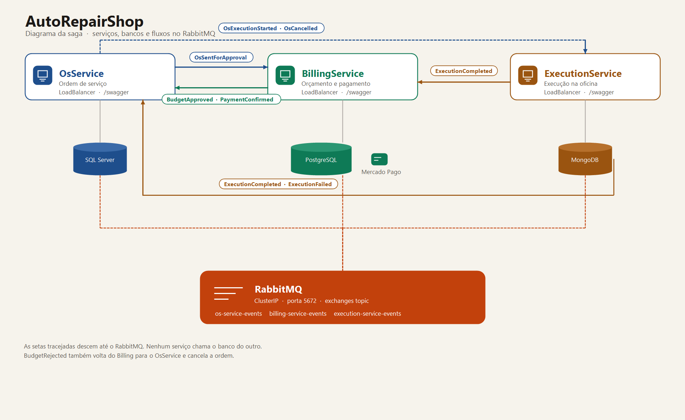

# AutoRepairShop — BillingService

Microsserviço responsável por **orçamentos e pagamentos** (integração [Mercado Pago](https://www.mercadopago.com.br/developers/pt)).  
Parte da arquitetura distribuída do **Tech Challenge Fase 4 · 12SOAT**.

## Arquitetura



Os três serviços ficam no namespace `autorepair`. Cada API tem LoadBalancer e Swagger. O RabbitMQ continua `ClusterIP`: os pods publicam e consomem na porta 5672.

```
src/
├── BillingService.Api            → Controllers REST, Swagger, Program.cs
├── BillingService.Application    → App Services, DTOs, Event Handlers (Saga consumers)
├── BillingService.Domain         → Entidades Budget/Payment, Enums, Domain Events
└── BillingService.Infrastructure → EF Core (PostgreSQL), RabbitMQ, Mercado Pago
tests/
└── BillingService.Tests
    ├── Unit/                     → Testes unitários (xUnit + FluentAssertions + Moq)
    └── BDD/                      → Cenários Gherkin da saga (Reqnroll)
k8s/                              → Deployment, Service, HPA, ConfigMap
.github/workflows/ci.yml          → CI/CD (Build → Testes → SonarQube → Docker → K8s)
```

## Banco de dados

**PostgreSQL 16** — banco próprio e isolado (ACID para transações financeiras).

## Fluxo de Status

### Orçamento (Budget)

```
Draft → Sent → Approved
              ↘ Rejected
```

### Pagamento (Payment)

```
Pending → Confirmed
        ↘ Failed
```

## Saga Pattern — Coreografado

### Eventos publicados (RabbitMQ · exchange: `billing-service-events`)

| Evento | Quando | Consumidor |
|---|---|---|
| `BudgetGeneratedEvent` | Orçamento enviado | ExecutionService |
| `BudgetApprovedEvent` | Cliente aprova | ExecutionService |
| `BudgetRejectedEvent` | Cliente rejeita | OsService (cancela OS) |
| `PaymentConfirmedEvent` | MP confirma pagamento | OsService (fecha OS) |
| `PaymentFailedEvent` | MP recusa pagamento | OsService |

### Eventos consumidos

| Evento | Origem | Ação |
|---|---|---|
| `OsSentForApproval` | OsService | Cria o Budget e popula os itens diagnosticados |
| `OsCancelled` | OsService | Cancela Budget e Payment pendentes |
| `ExecutionCompleted` | ExecutionService | Inicia checkout MP + cria Payment |

## Integração Mercado Pago (Checkout Pro)

1. `POST /api/payment/checkout/{osId}` cria Preference e retorna `checkoutUrl`
2. Cliente paga na página do Mercado Pago
3. MP notifica `POST /api/payment/webhook`
4. Serviço consulta `/v1/payments/{id}` e confirma/falha o Payment
5. Publica `PaymentConfirmed` ou `PaymentFailed` no broker

Em desenvolvimento local, use `"MercadoPago:UseStub": true`.

## Endpoints REST

| Método | Rota | Descrição |
|---|---|---|
| `GET` | `/api/budget/{id}` | Busca orçamento por ID |
| `GET` | `/api/budget/os/{osId}` | Busca orçamento da OS |
| `POST` | `/api/budget/{id}/items` | Adiciona item (Draft) |
| `POST` | `/api/budget/{id}/send` | Envia orçamento (BudgetGenerated) |
| `POST` | `/api/budget/{id}/approve` | Aprova orçamento |
| `POST` | `/api/budget/{id}/reject` | Rejeita orçamento |
| `POST` | `/api/payment/checkout/{osId}` | Inicia checkout MP |
| `GET` | `/api/payment/os/{osId}` | Consulta pagamento |
| `POST` | `/api/payment/webhook` | Webhook Mercado Pago |
| `GET` | `/health` | Health check |

Swagger: `http://localhost:5011/swagger`

## Executando com Docker

```bash
docker compose up -d
```

Sobe API (porta **5011**), PostgreSQL (**5432**) e RabbitMQ (**5672** / UI **15672**).

## Testes

```bash
dotnet test
dotnet test --collect:"XPlat Code Coverage"
```

Cobertura mínima exigida pelo pipeline: **80%** de linhas. Abaixo disso o job `Build, Test & Quality` falha.

Medição local em 5 de novembro de 2026, configuração Release, relatório OpenCover do Coverlet:

| Testes | Linhas cobertas | Cobertura de linhas |
|---|---|---|
| 40 aprovados | 280 / 332 | **84,3%** |

### BDD (Gherkin)

Os cenários ficam em `tests/BillingService.Tests/BDD/OrcamentoDaSaga.feature`, escritos em português (`# language: pt`). O Reqnroll (sucessor do SpecFlow) transforma cada `Cenário` em teste xUnit e liga os passos à classe `OrcamentoDaSagaSteps`. A execução é em memória: repositório e publicador de eventos são falsos, sem PostgreSQL nem RabbitMQ.

| Cenário | O que confere |
|---|---|
| Cliente aprova o orçamento | `Draft`, depois `Approved` e `BudgetApprovedEvent` |
| Cliente recusa o orçamento | `Rejected` e `BudgetRejectedEvent` |
| Cancelamento da ordem desfaz o orçamento | `Cancelled` |

```powershell
dotnet test tests/BillingService.Tests/BillingService.Tests.csproj --filter FullyQualifiedName~BDD
```

### SonarQube

O job `Build, Test & Quality` analisa o código com o SonarScanner para .NET: o `begin` envolve o build, os testes geram o OpenCover e o `end` publica o resultado. A chave é `AutoRepairOrg_AutoRepairShop-BillingService`, na organização `autorepairorg`.

Painel: [sonarcloud.io/summary/overall?id=AutoRepairOrg_AutoRepairShop-BillingService](https://sonarcloud.io/summary/overall?id=AutoRepairOrg_AutoRepairShop-BillingService)

O repositório precisa do secret `SONAR_TOKEN` (e, se quiser outro host, `SONAR_HOST_URL`). Sem o token o job para antes do build. O Quality Gate desse projeto passa a existir no primeiro push em que o scanner termina.

## Observabilidade (Datadog)

Logs, traces e métricas saem quando `DD_API_KEY` está definida. Sem a chave o serviço sobe e o log fica no console.

No cluster, crie o secret uma vez no namespace `autorepair` (os três deployments leem o mesmo):

```bash
kubectl -n autorepair create secret generic datadog-secret --from-literal=api-key=SUA_API_KEY
```

O modelo está em `k8s/datadog-secret.example.yaml`. O valor `SUBSTITUA_PELA_API_KEY` não é enviado. Se a organização for da Europa, troque `DD_SITE` no deployment de `datadoghq.com` para `datadoghq.eu`.

Na máquina local:

```powershell
$env:DD_API_KEY = "SUA_API_KEY"
$env:DD_SITE = "datadoghq.com"
```

O `docker compose` repassa essas variáveis. O serviço deste repositório publica como `billing-service`.

No Datadog, Logs → Explorer: `service:billing-service`. A saga aparece com `event_type` e `correlation_id`. APM → Traces mostra o span `saga consume` ligado ao `saga publish` do serviço anterior pelo header `traceparent`. Métricas: `autorepair.saga.published`, `autorepair.saga.consumed`, `autorepair.saga.failed`, `autorepair.http.requests`, `autorepair.http.duration`.

O painel para importar está em `observability/datadog-dashboard.json` (Dashboards → New Dashboard → Import dashboard JSON).

## Tech Stack

- .NET 8 / ASP.NET Core
- Entity Framework Core + PostgreSQL 16
- Mercado Pago Checkout Pro (REST API)
- RabbitMQ (mensageria — Saga coreografado)
- xUnit + FluentAssertions + Moq
- Reqnroll + Gherkin (BDD)
- Docker + Kubernetes
- GitHub Actions (CI/CD)
- SonarQube
- OpenTelemetry + Serilog (logs, traces e métricas no Datadog)

## Autores

Projeto desenvolvido por **Dhiulia da Silva** e **Mateus Pinheiro** · 12SOAT Fase 4
